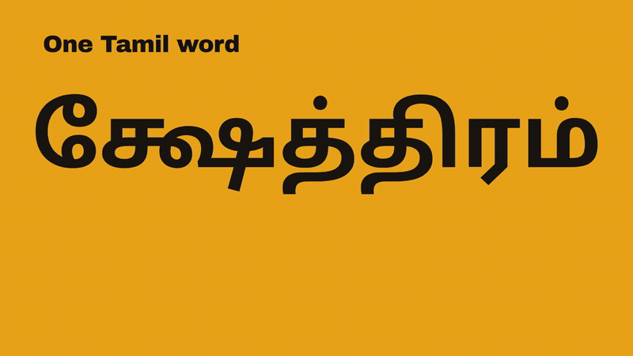

# PaddleOCR for Tamil: Akshara Recognition

A fork of [PaddleOCR](https://github.com/PaddlePaddle/PaddleOCR) that teaches PP-OCRv5's text recogniser to
read Tamil in the units people actually write it in: **aksharas** (syllables), not Unicode code points.

<p align="center">
  <a href="docs/demo.mp4"></a>
  <br><a href="docs/demo.mp4"><b>▶ Watch the 34-second explainer (with sound)</b></a>
</p>

## The problem

A Tamil syllable is often several code points: a consonant, a virama, a vowel sign. PaddleOCR's stock
recogniser predicts one code point per step, so one written shape becomes several prediction steps,
including invisible marks that have to come out in exactly the right order.

```
க்ஷேத்திரம்
code points  க ் ஷ ே த ் த ி ர ம ்     11 steps, 5 of them invisible marks
aksharas     க்  ஷே  த்  தி  ர  ம்               6 steps, one per written shape
```

This fork tokenises recognition labels as Unicode grapheme clusters, `regex.findall(r"\X", text)`, over a
fixed 355-token dictionary ([`akshara/dict.txt`](akshara/dict.txt)) built from an audit of 80,022 Tamil
labels. Each prediction step is one written shape. Training uses the
[IndicMozhi Tamil](https://huggingface.co/datasets/darknight054/indic-mozhi-ocr) dataset.

## What changed, and what didn't

| | |
|---|---|
| **Changed** | The recognition label tokeniser (code points → grapheme clusters), the dictionary, and the PP-OCRv5 mobile and server rec configs that point to it |
| **Unchanged** | The backbone, neck, `MultiHead` / `CTCHead`, `CTCLoss`, `CTCLabelDecode`, blank handling and confidence scores |
| **Fine-tuning** | Starts from PaddleOCR's Tamil `ta_PP-OCRv5_mobile_rec` weights. Every shape-compatible layer loads; only the final classifier is re-initialised for the new vocabulary |

Because the model only ever sees a different label alphabet, any PP-OCRv5 tooling (training, eval,
export, inference) works as it does upstream.

## Try it

```bash
python -m venv .venv && .venv/bin/pip install -r requirements.txt paddlepaddle regex
.venv/bin/python verify_akshara.py     # tokenise → encode → decode round trip
.venv/bin/python verify_model.py       # model output shape and CTC loss with the new vocabulary
```

```
text: வணக்கம்
tokens: ['வ', 'ண', 'க்', 'க', 'ம்']
encoded IDs: [6, 74, 4, 1, 3]
decoded text: வணக்கம்
Akshara encode -> decode round-trip: OK
```

## Training

Data is PaddleOCR's usual `image_path<TAB>label` list. Longest label in the audited dataset is 50
aksharas, so set `Global.max_text_length: 50` for full runs (the stock 25 is fine for smoke tests).

```bash
.venv/bin/python tools/train.py -c configs/rec/PP-OCRv5/PP-OCRv5_mobile_rec.yml
```

For a SLURM GPU cluster with an offline compute node, [`remote_gpu_execution/`](remote_gpu_execution/)
has four scripts: `setup.sh` on the login node fetches dependencies and the dataset, then `sbatch train.py`
trains and exports an inference model. The whole chain has been smoke-tested end to end on CPU.

[README_AKSHARA.md](README_AKSHARA.md) covers training, resuming, evaluation, inference and export
step by step, and [architecture.md](architecture.md) covers the data layer.

## Upstream

Everything else in this repository is PaddleOCR 3.x as published by PaddlePaddle under the
[Apache 2.0 licence](LICENSE): detection, PP-StructureV3, PaddleOCR-VL and the rest. Its documentation is
at [paddlepaddle.github.io/PaddleOCR](https://paddlepaddle.github.io/PaddleOCR/).
